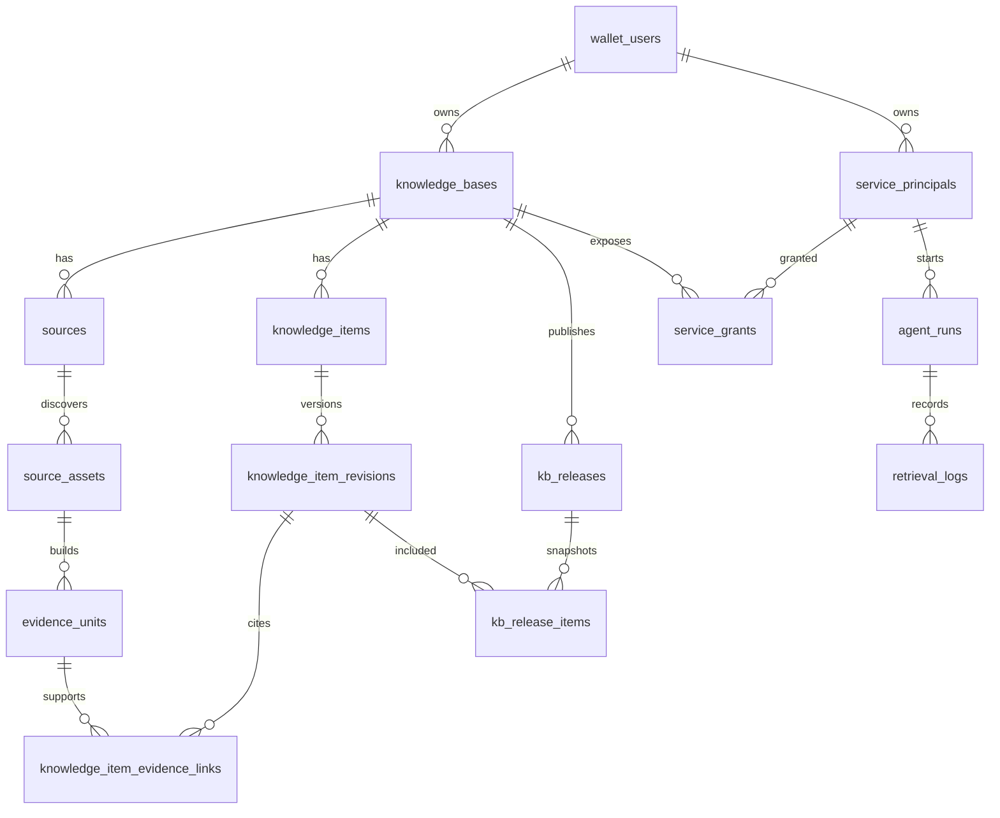

# Knowledge 数据模型

本文描述 Knowledge 数据库中的实体、关系、关键约束和状态取值，面向开发、评审和数据迁移的读者。它回答“数据怎么组织、哪些不变量由数据库保证”；术语定义见[核心概念](核心概念.md)，数据如何在组件间流动见[系统架构](系统架构.md)，接口字段以 [OpenAPI](../openapi/knowledge.openapi.yaml) 为准。

> 状态基线：2026-11-10，`main` 分支已提交代码。权威来源是 `knowledge/models/entities.py`、`knowledge/models/ontology.py` 和 `migrations/versions/`；本文与它们冲突时以代码为准。

## 总览

- **数据库**：PostgreSQL，schema 由 Alembic 迁移管理，CI 用 `alembic check` 保证模型与迁移不漂移。
- **规模**：43 张表，按领域分为八组（见下文各节）。另有一张表处于“进行中”，见[进行中的变更](#进行中的变更)。
- **租户边界**：知识库（`knowledge_bases`）归一个钱包地址（`owner_wallet_address`）所有，绝大多数业务表通过 `kb_id` 挂在知识库下。服务主体、凭证、Agent 运行等不属于单个知识库的表，直接以 `owner_wallet_address` 标识所有者。
- **不保存在这里的数据**：文件原文、分析产物和运行清单保存在 Warehouse；数据库只保存路径、校验值（ETag、sha256）和元数据。向量在 `vector_store_mode=weaviate` 时存在 Weaviate，`db` 模式下以 JSON 存在 `unit_embeddings` / `embeddings` 表中。

图中只画主干关系；各节给出完整的表和约束。

## 工作区与身份

| 表 | 模型 | 作用 | 关键约束 |
| --- | --- | --- | --- |
| `wallet_users` | `WalletUser` | 钱包用户，主键即钱包地址 | `identity_did` 唯一（可空） |
| `auth_challenges` | `AuthChallenge` | 钱包签名登录的一次性挑战 | `nonce` 唯一；`consumed` 防重放 |
| `passport_login_sessions` | `PassportLoginSession` | 通行证（Node 授权码流程）登录会话，含 PKCE `code_verifier` | `request_id`、`state` 唯一 |
| `passport_subjects` | `PassportSubject` | 通行证 subject 与钱包的对应 | FK `wallet_address → wallet_users` |
| `knowledge_bases` | `KnowledgeBase` | 知识库，含检索配置 `retrieval_config` | FK `owner_wallet_address → wallet_users`；`(id, owner_wallet_address)` 唯一，供本体表做复合外键 |

## Warehouse 接入

| 表 | 模型 | 作用 | 关键约束 / 取值 |
| --- | --- | --- | --- |
| `warehouse_access_credentials` | `WarehouseAccessCredential` | 所有者导入的 Warehouse 访问密钥，`encrypted_key_secret` 加密保存，限定 `root_path` | `credential_kind`：`read` / `read_write`；`status`：`active` / `invalid` / `revoked_local`；`(owner, kind, key_id, root_path)` 唯一 |
| `source_bindings` | `SourceBinding` | 绑定到知识库的 Warehouse 文件或目录，导入任务的输入 | `(kb_id, source_path)` 唯一；`credential_id` 指向读凭证，**无数据库外键**，由服务层校验 |
| `upload_records` | `UploadRecord` | 经控制台上传到 Warehouse 的文件记录 | 无外键，按 `owner_wallet_address` 归属 |

## 导入索引

导入任务的产物。控制台的“来源文档”“切片”视图读这一组表；对外服务检索（`/service/search*`）**不读取**这一组表，而是读[来源与证据](#来源与证据)和[正式知识](#正式知识)。

| 表 | 模型 | 作用 | 关键约束 / 取值 |
| --- | --- | --- | --- |
| `import_tasks` | `ImportTask` | 导入、重建或删除任务 | `task_type`：`import` / `reindex` / `delete`；Worker 领取字段 `claimed_by`、`claimed_at`、`heartbeat_at`、`attempt`、`last_stage` |
| `import_task_items` | `ImportTaskItem` | 任务的逐文件明细，含阶段、耗时、错误类型 | FK `task_id → import_tasks` |
| `documents` | `ImportedDocument` | 导入的文档 | `(kb_id, source_path)` 唯一；`source_etag_or_mtime` 用于增量判断 |
| `chunks` | `ImportedChunk` | 文档切片 | FK `document_id → documents` |
| `embeddings` | `EmbeddingRecord` | 切片向量 | `chunk_id` 唯一（每个切片一条） |
| `worker_status` | `WorkerStatus` | Worker 心跳与处理计数，供运维页展示 | 主键 `worker_name` |

## 来源与证据

| 表 | 模型 | 作用 | 关键约束 / 取值 |
| --- | --- | --- | --- |
| `sources` | `Source` | 知识源（来源根） | `(kb_id, source_path)` 唯一；`sync_status`：`pending_sync` / `syncing` / `synced` / `failed` / `source_missing` / `disabled`；`missing_policy`：`mark_missing` / `retain_index_until_confirmed` |
| `source_assets` | `SourceAsset` | 知识源下发现的文件 | `(source_id, asset_path)` 唯一；`availability_status`：`discovered` / `available` / `changed` / `missing` / `missing_unconfirmed` / `ignored`；`source_version` 记录来源版本 |
| `evidence_units` | `EvidenceUnit` | 证据单元：文本 + 来源定位 | FK `asset_id → source_assets`；`vector_status`：`pending` / `indexed` / `failed` |
| `unit_embeddings` | `UnitEmbeddingRecord` | 检索单元的向量 | `unit_kind`：`evidence` / `formal`；`(unit_kind, unit_id, embedding_model)` 唯一，因此切换模型时新旧向量可以并存；`text_hash` 用于判断是否需要重算 |

`unit_embeddings.unit_id` 按 `unit_kind` 分别指向证据单元或知识项修订，**不是数据库外键**。

## 正式知识

| 表 | 模型 | 作用 | 关键约束 / 取值 |
| --- | --- | --- | --- |
| `knowledge_item_candidates` | `KnowledgeItemCandidate` | 候选知识项，等待审核 | `review_status`：`pending_review` / `accepted` / `rejected` / `merged`；来源信息在 `provenance_json` |
| `knowledge_items` | `KnowledgeItem` | 知识项的稳定身份 | `lifecycle_status`：`candidate` / `confirmed` / `rejected` / `archived`；`origin_type`：`extracted` / `manual` / `manual_from_extracted` / `merged`；`current_revision_id` 指向当前修订，**不是数据库外键** |
| `knowledge_item_revisions` | `KnowledgeItemRevision` | 知识项的一版内容 | `(knowledge_item_id, revision_no)` 唯一；`review_status`：`draft` / `ready_for_review` / `accepted` / `rejected`；`visibility_status`：`active` / `archived` / `hotfix`；`effective_from` / `effective_to` 表示生效区间；`is_workspace_head` 标记工作区最新修订 |
| `knowledge_item_evidence_links` | `KnowledgeItemEvidenceLink` | 修订与证据的关联 | `(knowledge_item_revision_id, evidence_unit_id, role)` 唯一；`rank` 排序 |

只有 `lifecycle_status = confirmed` 且有当前修订的知识项会进入发布快照。

## 发布与授权

| 表 | 模型 | 作用 | 关键约束 / 取值 |
| --- | --- | --- | --- |
| `kb_releases` | `KBRelease` | 发布版本 | `(kb_id, version)` 唯一；`supersedes_release_id` 指向它取代的上一个当前版本 |
| `kb_release_items` | `KBReleaseItem` | 发布快照中的一行 | `(release_id, knowledge_item_id)`、`(release_id, knowledge_item_revision_id)` 均唯一；`item_version_hash` 是修订内容的 SHA-256 |
| `service_principals` | `ServicePrincipal` | 外部服务的调用身份 | `(owner_wallet_address, service_id)` 唯一；只保存凭证指纹 `credential_fingerprint`，不保存 API Key 原文；`principal_status`：`active` / `disabled` / `revoked` |
| `service_grants` | `ServiceGrant` | 服务主体对知识库的检索授权 | `(kb_id, service_principal_id)` 唯一；`release_selection_mode`：`latest_published` / `pinned_release`（配合 `pinned_release_id`）；`grant_status`：`active` / `expired` / `revoked` / `suspended`；`default_result_mode` 默认 `compact` |
| `retrieval_logs` | `RetrievalLog` | 检索审计 | 可关联 `service_grant_id`、`service_principal_id`、`agent_run_id`、`release_id`；`query_mode`：`formal_first` / `formal_only` / `evidence_only` / `audit` / `search_lab_compare` |

### 发布状态

`KB_RELEASE_STATUSES` 定义了 `preparing`、`published`、`superseded`、`rolled_back` 四个值：

- 新发布、热修和回滚都直接创建为 `published`，并成为当前版本。当前代码**没有使用** `preparing`。
- 普通发布或热修时，原当前版本变为 `superseded`。
- 回滚时，**被回滚掉的原当前版本**变为 `rolled_back`；回滚的目标版本本身状态不变，系统另建一个内容与它相同的新版本。
- 当前版本是该知识库中 `published_at` 最新的 `published` 版本。

发布快照一经写入不再修改，因此[版本对比](核心概念.md#发布与检索)可以只比较两份快照，不受工作区后续编辑影响。

## Agent 运行

| 表 | 模型 | 作用 | 关键约束 / 取值 |
| --- | --- | --- | --- |
| `agent_runs` | `AgentRun` | 一次 Agent 运行 | `(service_principal_id, external_id)` 唯一，使调用方重复提交返回同一运行；`run_type`：`research` / `spreadsheet_analysis`；`status`：`queued` / `running` / `completed` / `failed` / `cancelled`；`manifest_sync_status`：`pending` / `synced` / `failed`；重试血缘 `retry_of_run_id`（自引用外键，唯一）与 `attempt` |
| `agent_run_inputs` | `AgentRunInput` | 运行输入引用 | `(run_id, input_key)` 唯一；冻结字段 `version_id`、`etag`、`sha256`、`size` |
| `agent_run_steps` | `AgentRunStep` | 运行阶段 | `(run_id, sequence)` 唯一 |
| `agent_run_events` | `AgentRunEvent` | 进度事件 | `(run_id, sequence)` 唯一，序号单调递增，支撑 SSE 续传 |
| `agent_run_artifacts` | `AgentRunArtifact` | 产物元数据 | `(run_id, artifact_key)` 唯一；`status`：`draft` / `final`；`generated_by_json` 记录生成工具与版本 |

运行的输入快照还以 JSON 保存在 `agent_runs.input_manifest_json`，上下文引用保存在 `context_manifest_json`；它们与子表一起被投影为 Warehouse 中的运行清单。

## 运营本体（实验性）

由 `ONTOLOGY_IDENTITY_ENABLED` 控制路由开关，表结构由迁移 `20261102_ontology_identity` 创建。所有本体表都带 `kb_id` 和 `owner_wallet_address`，并以复合外键指向 `knowledge_bases(id, owner_wallet_address)` 或同组的其他本体表，**由数据库保证**对象、标识、证据和评审只能引用同一知识库、同一所有者的记录。

| 表 | 模型 | 作用 | 关键约束 |
| --- | --- | --- | --- |
| `ontology_evidence_references` | `OntologyEvidenceReference` | 证据引用（URI、来源版本、定位、校验值） | `(id, kb_id, owner)` 唯一，供复合外键引用 |
| `ontology_objects` | `OntologyObject` | 本体对象 | `identity_status`：`candidate` / `confirmed` / `ambiguous` / `insufficient_evidence` |
| `ontology_external_identifiers` | `OntologyExternalIdentifier` | 外部标识 | `(kb_id, namespace, value)` 唯一：同一标识不能属于两个对象 |
| `ontology_identity_reviews` | `OntologyIdentityReview` | 身份评审历史 | 只追加 |
| `ontology_crosswalks` | `OntologyCrosswalk` | 权威对照 | `(kb_id, namespace, source_value)` 唯一 |
| `ontology_identifier_conflicts` | `OntologyIdentifierConflict` | 标识冲突，保存冲突前双方状态 | `(kb_id, existing_object_id, claimant_object_id, namespace, value)` 唯一 |
| `ontology_identifier_conflict_reports` | `OntologyIdentifierConflictReport` | 冲突的报告记录 | `(conflict_id, evidence_id, reported_by)` 唯一，使重复报告幂等 |
| `ontology_conflict_resolutions` | `OntologyConflictResolution` | 冲突裁决 | 主键 `conflict_id`：一个冲突只能裁决一次 |

本体表与知识项、发布版本、检索日志**没有关联**；本体数据不进入发布快照，也不参与服务检索。

## 兼容模块

| 表 | 模型 | 作用 |
| --- | --- | --- |
| `memories_long_term` | `LongTermMemory` | 按钱包保存的长期记忆，可关联知识库 |
| `memories_short_term` | `ShortTermMemory` | 按会话保存、带过期时间的短期记忆 |
| `memory_ingestion_events` | `MemoryIngestionEvent` | `/memory/ingest` 从问答中提取记忆的处理记录 |

这组表服务于保留的 `/memory/*` 兼容接口，不属于当前主产品流程。

## 跨表不变量

以下规则由服务层而不是外键保证，修改相关代码时需要保持：

1. `knowledge_items.current_revision_id` 必须指向属于该知识项的修订。
2. `source_bindings.credential_id` 必须指向同一所有者、权限覆盖绑定路径的读凭证；被绑定引用的凭证不能删除。
3. `unit_embeddings.unit_id` 必须按 `unit_kind` 指向存在的证据单元或修订。
4. 发布快照只包含 `confirmed` 的知识项，写入后不再修改。
5. `agent_run_inputs` 在运行开始后只在 resolve 阶段写入一次校验值，之后不再修改；重试新建运行，不改写原运行。
6. Agent 运行引用的知识（证据、知识项、检索日志）必须属于该服务主体有有效授权的知识库。

## 迁移

| 迁移 | 内容 |
| --- | --- |
| `20260929_0710-49e4dfb67e38_initial_schema` | 初始 schema |
| `20260929_2348-d72569034d1a_add_unit_embeddings` | 单元级向量表 |
| `20261029_1200-identity_wallet_login` | 钱包身份 DID 与通行证登录字段 |
| `20261102_1200-ontology_identity_persistence` | 运营本体身份与证据表 |
| `20261107_1200-agent_run_retry_lineage` | Agent 运行重试血缘 |

新增或修改模型时，在同一变更中添加迁移，并运行 `alembic upgrade head && alembic check` 确认无漂移；字段变化影响接口时同步导出 OpenAPI 并重新生成前端类型。

## 进行中的变更

以下改动已在开发中但**尚未合入** `main`，合入前不应视为当前模型：

- `warehouse_tool_credentials`（`WarehouseToolCredential`）：保存 Warehouse HTTP Tool 签发的短期、限定范围凭证（`scopes`、`path_prefixes`、`expires_at`），每个所有者一条。背景和阶段见 [Warehouse 集成收敛方案](../Warehouse集成收敛方案.md)。

## 维护约定

- 新增表或改变约束、状态取值时，在同一变更中更新本文。
- 状态取值以 `knowledge/models/entities.py` 中的常量为准；本文列出的取值需与之一致。
- 术语含义的变化先更新[核心概念](核心概念.md)，本文只描述存储结构。
