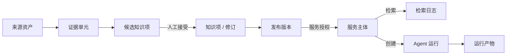

# Knowledge 核心概念

本文集中定义理解 Knowledge 所需的领域对象、角色和关键术语，面向第一次接触本项目的开发者、集成方和评审者。本文只回答“它是什么、在本项目里意味着什么、与相近概念有什么边界”；表结构见[数据模型](数据模型.md)，组件与数据流见[系统架构](系统架构.md)，接口字段以 [OpenAPI](../openapi/knowledge.openapi.yaml) 为准。

> 状态基线：2026-11-10，以 `main` 分支已提交代码为准。标注“实验性”的概念已合入但默认关闭。

## 项目模型

Knowledge 是面向人和 Agent 的**版本化知识控制面**：把来源资产加工为可追溯的证据，经人工审核沉淀为正式知识，按版本发布，再授权给 Chat、Agent、Project 等服务检索；同时为 Agent 运行记录输入、过程、产物和上下文来源。

两条边界贯穿全文：

- **所有者边界**：知识库归一个钱包地址所有。控制台操作以该钱包的访问令牌鉴权；外部服务只能经服务授权访问已发布的知识。
- **数据面边界**：文件内容由 Warehouse 保存，Knowledge 只保存资产引用、校验信息、证据文本和控制面元数据。模型调用经 Router，Knowledge 不管理模型渠道。

## 核心概念

术语的中英文名称以代码命名为准。没有通用简称时写 `—`。

### 身份与访问

| 中文全称 | 中文简称 | 英文全称 | 英文简称 | 在本项目中的含义 | 相关文档 |
| --- | --- | --- | --- | --- | --- |
| 钱包用户 | 用户 | Wallet User | — | 以钱包地址标识的用户，是知识库、凭证和服务主体的所有者。Knowledge 不持有钱包私钥。 | [系统架构](系统架构.md#身份与鉴权) |
| 知识库所有者 | 所有者 | Owner | — | 创建知识库的钱包地址。当前权限模型是 owner-only：没有协作者或独立的审核者角色。 | [数据模型](数据模型.md#工作区与身份) |
| 访问令牌 | 令牌 | JSON Web Token | JWT | 钱包登录后签发的令牌，控制台和所有者接口用 `Authorization: Bearer` 携带。 | [API 接入文档](../integrations/API接入文档.md) |
| 夜莺通行证登录 | 通行证登录 | Passport Login | — | 经 Node 授权码流程完成 Passkey 或钱包身份出示登录，最终仍换取本项目的访问令牌。 | [系统架构](系统架构.md#身份与鉴权) |
| 钱包身份标识 | 身份标识 | Wallet Identity Decentralized Identifier | DID | 钱包身份登录时绑定到钱包用户的 DID（`identity_did`），一个 DID 只对应一个钱包用户。 | [数据模型](数据模型.md#工作区与身份) |
| 服务主体 | — | Service Principal | — | 代表一个外部服务（如 Chat）的调用身份，由所有者创建，用 `X-Service-Api-Key` 鉴权。它不是用户。 | [控制面 API 文档](../integrations/控制面API文档.md) |
| 服务授权 | 授权 | Service Grant | Grant | 允许某个服务主体检索某个知识库，并决定它读当前发布版本还是固定版本。可过期、可撤销。 | [控制面 API 文档](../integrations/控制面API文档.md) |
| Warehouse 访问凭证 | 读/写凭证 | Warehouse Access Credential | — | 所有者导入的 Warehouse 访问密钥，分只读（`read`）和读写（`read_write`），限定根路径，密钥加密保存。 | [Warehouse 凭证使用说明](../integrations/Warehouse凭证使用说明.md) |
| Warehouse 工具凭证 | 工具凭证 | Warehouse Tool Credential | — | 所有者用 Warehouse 登录令牌换取、由 Warehouse 签发的限定范围（`scopes`、`path_prefixes`）且会过期的 Tool 凭证，加密保存。存在且未过期时，文件读写优先经 HTTP Tool。 | [Warehouse 集成收敛方案](../integrations/Warehouse集成收敛方案.md) |

### 知识生产

| 中文全称 | 中文简称 | 英文全称 | 英文简称 | 在本项目中的含义 | 相关文档 |
| --- | --- | --- | --- | --- | --- |
| 知识库 | — | Knowledge Base | KB | 知识生产、发布和授权的基本单位，归一个所有者。下文的绝大多数对象都挂在知识库下。 | [数据模型](数据模型.md#工作区与身份) |
| 绑定源 | — | Source Binding | — | 把一个 Warehouse 文件或目录绑定到知识库，并指定读取它的凭证；导入任务以它为输入。 | [控制台操作手册](../guides/控制台操作手册.md) |
| 知识源 | 来源 | Source | — | 知识库的一个来源根，带来源类型（`warehouse`、`local_file`、`github_repository`）和同步状态；扫描后产生来源资产。 | [数据模型](数据模型.md#来源与证据) |
| 来源资产 | 资产 | Source Asset | — | 知识源下发现的一个文件，记录路径、来源版本和可用状态，是证据的上游。 | [数据模型](数据模型.md#来源与证据) |
| 导入任务 | — | Import Task | — | 由 Worker 异步执行的导入、重建或删除任务，带领取、心跳、重试和逐文件明细。 | [Worker 部署与扩缩容建议](../operations/Worker部署与扩缩容建议.md) |
| 导入文档 / 导入切片 | 文档 / 切片 | Imported Document / Imported Chunk | — | 导入任务产生的文档级记录和文本切片，用于控制台的文档与切片查看。对外服务检索不读取切片。 | [数据模型](数据模型.md#导入索引) |
| 证据单元 | 证据 | Evidence Unit | — | 从来源资产构建、带来源定位（`source_locator`）的一段文本，是正式知识的依据，也是证据检索的检索对象。 | [系统架构](系统架构.md#知识生产写路径) |
| 候选知识项 | 候选 | Knowledge Item Candidate | Candidate | 由证据生成、等待人工审核的知识陈述。接受后才成为知识项；候选本身不会被发布。 | [系统架构](系统架构.md#知识生产写路径) |
| 知识项 | — | Knowledge Item | Item | 经审核确认的正式知识的稳定身份，内容由修订承载。 | [数据模型](数据模型.md#正式知识) |
| 知识项修订 | 修订 | Knowledge Item Revision | Revision | 知识项某一版内容（标题、陈述、结构化载荷、生效区间）。修改知识项会产生新修订，旧修订保留。 | [数据模型](数据模型.md#正式知识) |
| 证据关联 | — | Knowledge Item Evidence Link | Evidence Link | 把一个修订关联到支撑它的证据单元，用于回溯“这条知识依据什么”。 | [数据模型](数据模型.md#正式知识) |
| 知识项契约 | 契约 | Item Contract | — | 按知识项类型（如 `fact`、`rule`）校验结构化载荷的规则，带契约版本号；不合规的知识项无法创建。 | [控制面 API 文档](../integrations/控制面API文档.md) |

### 发布与检索

| 中文全称 | 中文简称 | 英文全称 | 英文简称 | 在本项目中的含义 | 相关文档 |
| --- | --- | --- | --- | --- | --- |
| 发布版本 | 发布 | Knowledge Base Release | Release | 知识库在某一时刻的只读快照，记录每个知识项当时的修订。同一知识库同一时刻只有一个当前发布版本。 | [系统架构](系统架构.md#发布) |
| 发布项 | — | Knowledge Base Release Item | Release Item | 发布快照中的一行：知识项、修订和内容哈希（`item_version_hash`）。 | [数据模型](数据模型.md#发布与授权) |
| 热修发布 | 热修 | Hotfix Release | Hotfix | 基于某个发布版本、只替换选定知识项而生成的新发布版本。 | [控制台操作手册](../guides/控制台操作手册.md) |
| 回滚发布 | 回滚 | Rollback Release | Rollback | 以旧版本的快照生成一个**新**发布版本，不删除或改写任何历史版本。 | [控制台操作手册](../guides/控制台操作手册.md) |
| 版本对比 | 对比 | Release Diff | Diff | 比较两个发布快照，把知识项分为新增、移除、变更、未变。 | [OpenAPI](../openapi/knowledge.openapi.yaml) |
| 正式知识检索 | 正式检索 | Formal Retrieval | — | 只在发布版本的知识项修订中检索（`formal_only`）。 | [API 接入文档](../integrations/API接入文档.md) |
| 证据检索 | — | Evidence Retrieval | — | 只在证据单元中检索（`evidence_only`）。 | [API 接入文档](../integrations/API接入文档.md) |
| 正式优先检索 | — | Formal-first Retrieval | — | 先检索正式知识，不足时补充证据（`formal_first`），是服务检索的默认推荐模式。 | [API 接入文档](../integrations/API接入文档.md) |
| 混合检索 | — | Hybrid Retrieval | — | 关键词召回与向量召回经倒数排名融合后再重排。向量与重排只在真实模型网关下生效，mock 模式下等价于纯关键词。 | [混合检索与真实模型落地设计](混合检索与真实模型落地设计.md) |
| 倒数排名融合 | — | Reciprocal Rank Fusion | RRF | 混合检索中合并多路召回排名的方法。 | [混合检索与真实模型落地设计](混合检索与真实模型落地设计.md) |
| 重排 | — | Rerank | — | 用重排模型对融合后的前若干名重新排序；调用失败时降级为融合顺序。 | [混合检索与真实模型落地设计](混合检索与真实模型落地设计.md) |
| 单元向量 | — | Unit Embedding | — | 为证据单元或正式知识修订计算的向量，按 `unit_kind`（`evidence`/`formal`）区分；存数据库或 Weaviate。 | [向量索引运维手册](../operations/向量索引运维手册.md) |
| 检索日志 | — | Retrieval Log | — | 每次检索的审计记录：谁、以什么模式、在哪个发布版本上查了什么、命中了什么。 | [数据模型](数据模型.md#发布与授权) |
| 检索实验台 | — | Search Lab | — | 控制台中对比不同检索方式结果的工具，结果也记入检索日志。 | [控制台操作手册](../guides/控制台操作手册.md) |

### Agent 运行

| 中文全称 | 中文简称 | 英文全称 | 英文简称 | 在本项目中的含义 | 相关文档 |
| --- | --- | --- | --- | --- | --- |
| Agent 运行 | 运行 | Agent Run | Run | 服务主体发起的一次可审计执行，记录输入、上下文来源、状态和产物。类型有 `research` 和 `spreadsheet_analysis`。 | [Agent 运行与上下文资产设计](Agent运行与上下文资产设计.md) |
| 表格分析运行 | 表格分析 | Spreadsheet Analysis Run | — | 由 Knowledge Worker 执行的 CSV/XLSX 分析运行，按 resolve、profile、plan、execute、publish 分阶段推进。 | [CSV 与 Excel 分析 Agent 开发说明](../guides/CSV与Excel分析Agent开发说明.md) |
| 运行输入 | 输入 | Agent Run Input | — | 运行引用的 Warehouse 资产。开始执行时冻结 sha256 等校验信息，之后不再改变。 | [数据模型](数据模型.md#agent-运行) |
| 运行步骤 | 步骤 | Agent Run Step | Step | 运行中的一个阶段及其状态、指标和错误。 | [数据模型](数据模型.md#agent-运行) |
| 运行事件 | 事件 | Agent Run Event | — | 按序号递增的进度事件，支持增量查询和 SSE 断线续传。 | [CSV 与 Excel 分析 Agent 开发说明](../guides/CSV与Excel分析Agent开发说明.md) |
| 运行产物 | 产物 | Agent Run Artifact | Artifact | 运行生成并写回 Warehouse 的文件（报告、结果表、图表等）的元数据和来源信息。 | [数据模型](数据模型.md#agent-运行) |
| 运行清单 | 清单 | Run Manifest | Manifest | 运行事实（输入、上下文、产物）在 Warehouse 中的可移植 JSON 投影；以数据库为准，写入失败可重试。 | [Agent 运行与上下文资产设计](Agent运行与上下文资产设计.md) |
| 上下文引用 | — | Context Reference | — | 运行声明使用过的上下文来源：Warehouse 资产、证据、知识项、检索日志或工具输出；引用的知识必须在服务授权范围内。 | [Agent 运行与上下文资产设计](Agent运行与上下文资产设计.md) |
| 重试尝试 | 尝试 | Attempt | — | 对失败或取消的表格分析运行重试时新建的子运行，复用冻结输入，`attempt` 递增；原运行不被改写。 | [CSV 与 Excel 分析 Agent 开发说明](../guides/CSV与Excel分析Agent开发说明.md) |

### 运营本体（实验性，默认关闭）

由 `ONTOLOGY_IDENTITY_ENABLED` 开启，关闭时相关路由返回 404。它只处理对象身份与证据，不代表通用本体平台已经建成；产品价值仍待 Task 238 的独立验证。

| 中文全称 | 中文简称 | 英文全称 | 英文简称 | 在本项目中的含义 | 相关文档 |
| --- | --- | --- | --- | --- | --- |
| 本体对象 | 对象 | Ontology Object | — | 知识库下的合同、产品或组织等业务实体，身份状态为 `candidate`、`confirmed`、`ambiguous` 或 `insufficient_evidence`。 | [运营本体 V1 生产身份切片](../ontology/运营本体V1生产身份切片.md) |
| 外部标识 | 标识 | External Identifier | — | 来源系统中的实体编号，按（命名空间, 值）在一个知识库内唯一。 | [运营本体 V1 生产身份切片](../ontology/运营本体V1生产身份切片.md) |
| 权威对照 | 对照 | Crosswalk | — | 由权威机构证明“来源标识对应规范标识”的映射。对象只能经权威对照确认身份，名称相似不算。 | [运营本体 V1 生产身份切片](../ontology/运营本体V1生产身份切片.md) |
| 标识冲突 | 冲突 | Identifier Conflict | — | 一个标识被另一个对象认领时产生的待裁决记录，期间双方都处于 `ambiguous`。 | [运营本体 V1 生产身份切片](../ontology/运营本体V1生产身份切片.md) |
| 冲突裁决 | 裁决 | Conflict Adjudication | — | 对冲突作出的决定；当前只支持驳回认领（`claim_rejected`），不合并对象。 | [运营本体 V1 生产身份切片](../ontology/运营本体V1生产身份切片.md) |

### 运行组件与兼容模块

| 中文全称 | 中文简称 | 英文全称 | 英文简称 | 在本项目中的含义 | 相关文档 |
| --- | --- | --- | --- | --- | --- |
| 后台工作进程 | 工作进程 | Worker | — | 独立于 API 运行的常驻进程，领取并执行导入任务和排队中的表格分析运行。 | [Worker 部署与扩缩容建议](../operations/Worker部署与扩缩容建议.md) |
| 端口 / 适配器 | — | Port / Adapter | — | 领域服务依赖的抽象接口（端口）及其具体实现（适配器），如来源连接、文档解析、切片、索引和资产存储。 | [系统架构](系统架构.md#端口与适配器) |
| 模拟模式 | mock | Mock Mode | — | 模型或 Warehouse 使用本地替身实现的运行模式，仅用于开发和测试；生产启动守卫会拒绝它。 | [部署指南](../operations/部署指南.md) |
| 记忆 | — | Memory | — | **兼容模块**：按钱包保存的长期记忆与带过期时间的会话短期记忆（`/memory/*`），已不是当前主产品叙事。 | [API 接入文档](../integrations/API接入文档.md) |

## 容易混淆的概念

| 概念 A | 概念 B | 关键区别 |
| --- | --- | --- |
| 绑定源 | 知识源 | 绑定源服务于**导入任务**，必须指定 Warehouse 读凭证；知识源服务于**证据构建**，可以是 Warehouse、本地目录或 GitHub 仓库。同一路径可以两者都有，但它们是两张表、两条流程。 |
| 导入切片 | 证据单元 | 切片是导入任务的产物，用于控制台查看文档和切片；证据单元来自知识源扫描后的证据构建，带来源定位，是正式知识的依据和对外证据检索的对象。对外服务检索不读取切片。 |
| 候选知识项 | 知识项 | 候选是待审核的提议，可被拒绝，不会被发布；知识项是已确认的正式知识，才能进入发布版本。 |
| 知识项 | 知识项修订 | 知识项是稳定身份（ID 不变），修订是某一版内容。发布快照记录的是修订，所以修改知识项不会影响已发布版本。 |
| 工作区当前内容 | 发布版本 | 控制台编辑的是工作区里每个知识项的最新修订；外部服务只读取发布版本。发布后再修改，必须重新发布才对外生效。 |
| 回滚 | 删除版本 | 回滚生成一个内容等于旧版本的**新**版本，历史版本全部保留；Knowledge 不提供删除发布版本。 |
| 钱包用户 | 服务主体 | 钱包用户是人，持有知识库并在控制台操作；服务主体是外部服务的身份，只能做服务授权允许的检索和运行操作。 |
| 服务授权 | Warehouse 访问凭证 | 服务授权决定**谁能读 Knowledge 的知识**；Warehouse 凭证决定 **Knowledge 能读写哪些文件**。两者互不替代，也不会互相传递。 |
| 证据 | 运行产物 | 证据是从来源资产构建、用于支撑正式知识的文本；产物是 Agent 运行生成的文件。产物不会自动成为证据或知识，提升为知识的流程（promote）尚未实现。 |
| 导入任务 | Agent 运行 | 导入任务由所有者发起，生产索引和文档；Agent 运行由服务主体发起，记录一次可审计的分析或研究执行。两者都由 Worker 执行，但状态模型和接口各自独立。 |
| 运行重试 | 清单重试 | 运行重试（`/service/runs/{id}/retry`）新建一次执行尝试；清单重试（`/runs/{id}/manifest/retry`）只重新把已有事实写入 Warehouse，不重新执行。 |
| 知识项 | 本体对象 | 知识项是可发布、可检索的知识陈述；本体对象是业务实体的身份记录（实验性），不进入发布版本，也不参与服务检索。 |
| Warehouse 访问凭证 | Warehouse 工具凭证 | 访问凭证是所有者导入的长期密钥，绑定源和浏览都依赖它；工具凭证是会过期、限定范围的 Tool 凭证，只在文件读写经资产端口时优先使用。Tool 读不了的大对象仍回退到访问凭证，所以当前两者需要同时存在。 |

## 阅读路径

- 了解系统由什么组成、数据如何流动：看[系统架构](系统架构.md)。
- 查表、字段、约束和状态取值：看[数据模型](数据模型.md)。
- 外部服务如何接入、调用顺序：看 [API 接入文档](../integrations/API接入文档.md)。
- 查接口字段和错误语义：看 [OpenAPI](../openapi/knowledge.openapi.yaml)。
- 部署、Worker、备份和向量索引运维：看[部署指南](../operations/部署指南.md)、[Worker 部署与扩缩容建议](../operations/Worker部署与扩缩容建议.md)、[备份与恢复手册](../operations/备份与恢复手册.md)、[向量索引运维手册](../operations/向量索引运维手册.md)。
- Knowledge 与 Chat、Warehouse、Router 等社区产品的职责边界：看[社区产品关系与开发边界](社区产品关系与开发边界.md)。

## 维护约定

- 本文是 Knowledge 关键术语的集中定义处；其他文档引用术语时链接回本文，不复制定义。
- 新增或改变领域对象时，在同一变更中更新本文和[数据模型](数据模型.md)。
- 接口字段、配置项和操作步骤以链接的权威文档为准，本文不复制。
- 未实现的能力不得写成当前行为；实验性或尚未合入的概念必须标注状态。
