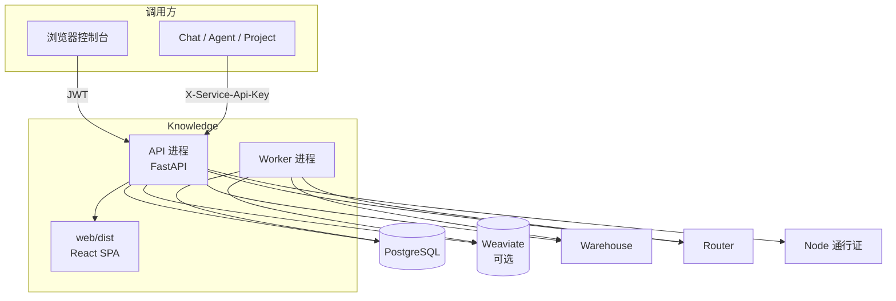
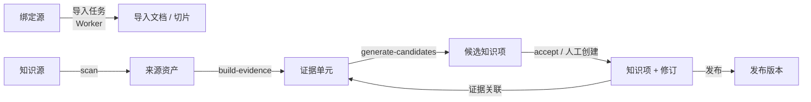
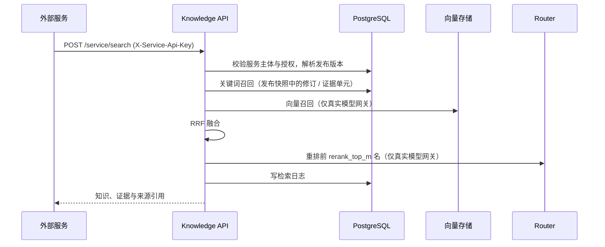
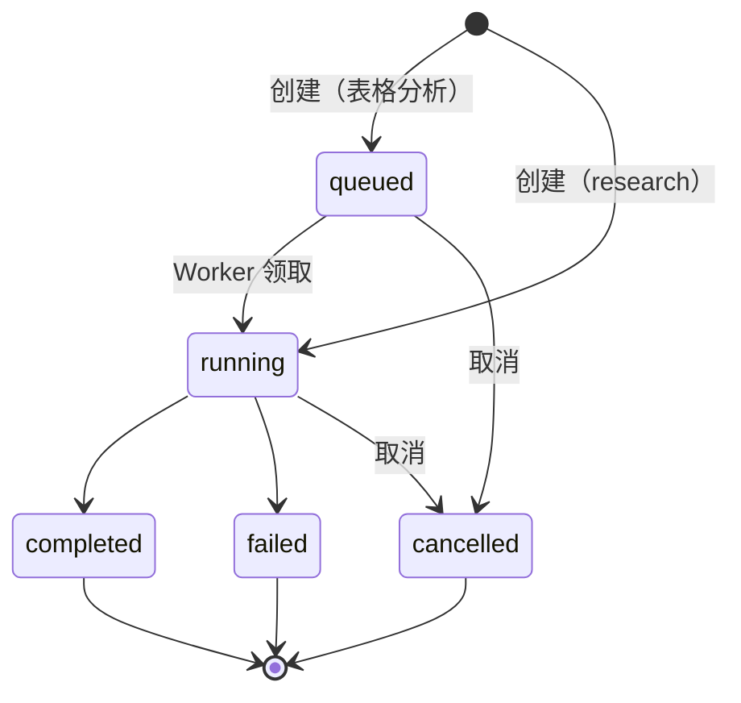

# Knowledge 系统架构

本文描述 Knowledge 由哪些组件组成、与社区其他产品如何分工、数据在写入和读取时如何流动，以及为什么这样设计。面向开发者、集成方和评审者。术语定义见[核心概念](核心概念.md)，表结构见[数据模型](数据模型.md)；部署步骤、接口字段和配置项分别以[部署指南](../operations/部署指南.md)、[OpenAPI](../openapi/knowledge.openapi.yaml)和 `.env.template` 为准，本文不复制。

> 状态基线：2026-11-10，`main` 分支已提交代码。已实现能力清单与已知限制见[知识库架构 V1](../roadmap/知识库架构V1.md)，尚未实现的目标见[知识库架构 V2](../roadmap/知识库架构V2.md)。

## 定位与边界

Knowledge 是**版本化知识控制面**：它拥有知识的生产流程、证据、正式知识、发布版本、服务授权、检索审计，以及 Agent 运行的输入、过程和产物元数据。它**不**保存文件内容，**不**管理模型渠道，**不**持有用户钱包私钥，也**不**托管长期运行的智能体进程。

| 系统 | 负责 | 与 Knowledge 的接口 |
| --- | --- | --- |
| **Knowledge** | 知识生产、证据、知识项、发布、服务授权、检索审计、Agent 运行控制面 | — |
| Warehouse | 文件内容、目录、对象版本、checksum、存储权限 | Knowledge 以所有者的访问凭证或 Tool 凭证读写文件；运行产物和清单写回 Warehouse |
| Router | 模型路由、额度与计量 | embedding、rerank 和分析计划生成经 OpenAI 兼容接口调用 Router |
| Node / Wallet | 用户身份、签名、Passkey 与钱包身份出示 | 钱包签名登录；通行证授权码流程 |
| Chat、Agent、Project | 知识和运行能力的消费方 | 以服务主体身份调用 `/service/*` |

社区层面的完整分工见[社区产品关系与开发边界](社区产品关系与开发边界.md)。

## 组件

| 组件 | 职责 | 启动方式 |
| --- | --- | --- |
| API 进程 | 所有 HTTP 接口；同时托管前端静态文件 `web/dist`；执行同步检索 | `knowledge` 命令（`knowledge/cli.py`，基于 uvicorn，默认 `127.0.0.1:8002`） |
| Worker 进程 | 领取并执行导入任务和排队中的表格分析运行；写心跳到 `worker_status` | `scripts/run_worker.sh <实例号>` |
| 前端控制台 | 知识库管理、资产与导入、知识生产、检索台、发布与授权、分析运行和运维页面 | `web/` 构建为 `web/dist` 后由 API 进程托管 |
| PostgreSQL | 唯一事实源：所有控制面数据、证据文本、知识和审计 | 外部依赖 |
| Weaviate | `vector_store_mode=weaviate` 时保存向量；`db` 模式下不需要 | 外部依赖，可选 |

API 和 Worker 是同一代码库的两个进程，共享数据库，通过数据库中的任务状态协作，不直接互相调用。Worker 可以多实例运行，用领取字段和心跳避免重复执行，见 [Worker 部署与扩缩容建议](../operations/Worker部署与扩缩容建议.md)。

## 代码结构

| 目录 | 内容 |
| --- | --- |
| `knowledge/api/` | FastAPI 路由（`routes_*.py`）与鉴权依赖 `deps.py` |
| `knowledge/services/` | 领域服务：导入、证据、候选、知识项、发布、检索、授权、Agent 运行、表格分析 |
| `knowledge/models/` | SQLAlchemy 模型，见[数据模型](数据模型.md) |
| `knowledge/schemas/` | Pydantic 请求/响应模型，导出为 OpenAPI |
| `knowledge/ports/` | 领域服务依赖的抽象接口 |
| `knowledge/adapters/` | 端口的具体实现：`connectors`（本地文件、GitHub）和 `ragflow`（解析、切片） |
| `knowledge/third_party/` | 搬入的第三方源码快照，只能经 adapter 调用；来源与许可证见 `SOURCES.md` |
| `knowledge/workers/` | Worker 主循环 |
| `knowledge/core/` | 配置（`settings.py`）与生产启动守卫 |
| `knowledge/ontology/` | 运营本体受控原型（内存态，仅用于演练） |
| `web/` | React SPA；`src/api/schema.d.ts` 由 OpenAPI 生成 |
| `migrations/` | Alembic 迁移 |
| `docs/openapi/` | OpenAPI 权威定义，由 `scripts/export_openapi.py` 从代码导出 |

接口契约的生成链路是：Pydantic 模型 → `export_openapi.py` → `docs/openapi/knowledge.openapi.yaml` → `npm run gen:api` → `web/src/api/schema.d.ts`。CI 分别检查 YAML 与代码、前端类型与 YAML 是否一致，任一环节漏改都会失败。

## 身份与鉴权

Knowledge 有两类调用方，鉴权方式和可访问范围不同：

| 调用方 | 凭证 | 可以做什么 |
| --- | --- | --- |
| 知识库所有者（人） | `Authorization: Bearer <JWT>` | 管理自己的知识库、凭证、导入、知识、发布、服务主体和授权 |
| 外部服务 | `X-Service-Api-Key` | 只能调用 `/service/*`：在授权范围内检索已发布知识，创建和查询自己的 Agent 运行 |

JWT 有三种获取方式：钱包签名挑战（`/auth/challenge` → `/auth/verify`）、通行证登录（经 Node 授权码流程完成 Passkey 或钱包身份出示）和开发环境的 Demo 登录。三者最终都签发本项目的访问令牌；Knowledge 不接触钱包私钥。

当前权限模型是 **owner-only**：知识库只有所有者一个人可写，没有协作者或审核者角色。服务主体的 API Key 只在创建时返回一次，数据库只保存指纹。

## 知识生产写路径

当前并存两条从文件出发的流程，职责不同：

1. **导入索引**：所有者把 Warehouse 文件或目录设为[绑定源](核心概念.md#知识生产)，创建导入任务；Worker 解析、切片并生成切片向量，结果用于控制台的文档与切片视图。
2. **证据生产**：[知识源](核心概念.md#知识生产)经 scan 发现来源资产，build-evidence 把资产解析为带来源定位的证据单元，generate-candidates 从证据生成候选知识项。所有者接受候选或手工创建后形成知识项及其修订，修订通过证据关联指向支撑它的证据。

对外服务检索只读第二条流程的产物。解析和切片可以通过 `DOCUMENT_PARSER_MODE` / `DOCUMENT_CHUNKER_MODE` 切换为 `ragflow` 适配，失败时回退本地实现。

**为什么候选必须人工确认**：证据由程序构建，候选由程序生成，只有人工接受的内容才成为可被发布的正式知识。这让 Knowledge 能回答“这条知识是谁、依据哪些证据确认的”，这也是它与通用问答产品的主要区别。

## 发布

发布把工作区中所有已确认知识项的当前修订写成一份只读快照。外部服务只读取发布版本，所以工作区的修改不会立即影响线上；修改后必须重新发布才对外生效。

- **普通发布**：快照当前工作区，原当前版本变为 `superseded`。
- **热修**：在某个发布版本的快照上只替换选定的知识项。
- **回滚**：用旧版本的快照生成一个新版本；不删除、不改写任何历史版本。
- **版本对比**：比较两份快照，列出新增、移除、变更和未变的知识项。

服务授权决定服务主体读哪个版本：`latest_published` 跟随当前版本，`pinned_release` 固定在某个版本上，便于调用方控制升级时机。

**为什么用快照而不是实时查询**：消费方依赖的是稳定内容。快照让“某次回答依据哪个版本的知识”可以复现，回滚也只是生成新快照，历史审计不受影响。

## 服务检索读路径

1. 校验服务主体和授权，按授权的版本选择方式确定发布版本。权限和可用性过滤在召回**之前**完成。
2. 按检索模式召回：`formal_only` 只查发布版本中的知识项修订；`evidence_only` 只查证据单元；`formal_first`（默认）先查正式知识，不足时补充证据，并排除已支撑正式命中的证据以免重复。
3. 关键词召回与单元向量召回经倒数排名融合（RRF），再对前若干名重排。
4. 每次检索写一条检索日志；若请求属于某次 Agent 运行，日志关联该运行。

**降级策略**：向量召回和重排只在 `MODEL_PROVIDER_MODE=openai_compatible` 时生效。mock 模式、向量未回填或模型调用失败时，检索降级为关键词或融合顺序，并在检索日志的 trace 中记录原因，不会因模型不可用而整体失败。

## Agent 运行

外部服务以服务主体身份创建 Agent 运行，Knowledge 记录它的输入、上下文来源、阶段、事件和产物。

- **`research` 运行**：由调用方自己执行。调用方通过接口声明上下文引用、上传产物，并结束运行（`complete` / `fail` / `cancel`）。
- **`spreadsheet_analysis` 运行**：由 Knowledge 的 Worker 执行。创建后处于 `queued`，Worker 领取后依次执行 resolve（冻结输入校验值）、profile、plan（可经 Router 把自然语言意图转为白名单计划）、execute、publish（写产物和清单到 Warehouse）。

- 进度以递增事件记录，支持增量查询和 SSE；断线后用 `Last-Event-ID` 续传。
- 失败或取消的表格分析运行可以重试：系统新建一次尝试，复用原运行冻结的输入，原运行不被改写。
- 运行事实以数据库为准，再投影为 Warehouse 中的运行清单；投影失败可单独重试，不影响运行本身。
- 运行引用的知识必须在该服务主体有有效授权的知识库内。

**为什么冻结输入**：分析结论必须能追溯到确切的文件版本。在 Warehouse 提供不可变版本标识之前，Knowledge 用路径 + ETag + sha256 作为过渡冻结键；文件被覆盖后，重试会因校验值不符而明确失败，而不是静默读取新内容。

已知限制：取消排队中的运行会立即生效；但对运行中的运行，Worker 目前不在阶段之间检查取消状态，会继续执行完剩余阶段（修复跟踪于 Task 263）。输入整文件读入内存，尚无流式处理。细节见 [CSV 与 Excel 分析 Agent 开发说明](../guides/CSV与Excel分析Agent开发说明.md)。

## 端口与适配器

领域服务通过端口依赖外部能力，以便替换实现而不改动领域模型。截至基线，端口的落地程度不同：

| 端口 | 职责 | 当前实现 | 状态 |
| --- | --- | --- | --- |
| `SourceConnectorPort` | 发现和读取来源资产 | `LocalFileConnector`、`GitHubRepositoryConnector` | 已使用。`warehouse` 类型的来源**不经过**此端口，直接调用 Warehouse 网关 |
| `DocumentParserPort` | 文档解析 | 本地实现；可选 `RAGFlowDocumentParser` | 已使用 |
| `DocumentChunkerPort` | 文本切片 | 本地实现；可选 `RAGFlowDocumentChunker` | 已使用 |
| `IndexBackendPort` | 向量索引后端 | — | 已定义，尚无代码通过它调用；向量存储直接使用 `DBVectorStore` / `WeaviateVectorStore` |
| `AssetStorePort` | Warehouse 文件读写（list、stat、read、write） | `AdaptiveWarehouseAssetStore`：有未过期 Tool 凭证时用 `WarehouseToolAssetStore`（HTTP Tool），否则用 `LegacyWarehouseAssetStore`（S3/WebDAV 网关）；Tool 读不了的大对象回退到网关 | 已使用：导入、证据构建、运行产物、运行清单、表格分析 |
| `RunExecutorPort` | 运行执行器 | — | 已定义，尚无代码通过它调用 |

Warehouse 浏览、上传和目录枚举仍直接调用 Warehouse 网关，不经过 `AssetStorePort`；迁移阶段与门槛见 [Warehouse 集成收敛方案](../integrations/Warehouse集成收敛方案.md)。

## 运行模式与配置

以下开关决定 Knowledge 连接真实依赖还是本地替身。完整配置项见 `.env.template`，部署要求见[部署指南](../operations/部署指南.md)。

| 配置 | 取值 | 默认 | 说明 |
| --- | --- | --- | --- |
| `MODEL_PROVIDER_MODE` | `mock` / `openai_compatible` | `mock` | `openai_compatible` 时经 `MODEL_GATEWAY_BASE_URL`（Router）调用 embedding、rerank 和计划生成 |
| `VECTOR_STORE_MODE` | `db` / `weaviate` | `db` | 向量存放位置 |
| `DOCUMENT_PARSER_MODE` / `DOCUMENT_CHUNKER_MODE` | `local` / `ragflow` | `local` | 解析与切片实现 |
| `SOURCE_CONNECTOR_MODE` | `warehouse` / `local_file` / `github_repository` | `warehouse` | 默认来源类型 |
| `WAREHOUSE_GATEWAY_MODE` | 空 / `mock` / `s3` / `bound_token` | 空 | 已废弃的兼容开关；为空时使用标准对象存储网关 |
| `ONTOLOGY_IDENTITY_ENABLED` | `true` / `false` | `false` | 开放实验性运营本体路由 |

**生产启动守卫**：非 development 环境下，进程启动时拒绝默认或占位的 JWT secret、`DEBUG=true`、`MODEL_PROVIDER_MODE=mock`、`WAREHOUSE_GATEWAY_MODE=mock` 以及未显式设置的 token 加密密钥。守卫不强制使用 Weaviate。

## 质量与验证

- **测试**：`scripts/test.sh` 运行 pytest；CI 在 PostgreSQL 上运行全量测试、迁移漂移检查（`alembic check`）、前端类型一致性检查、构建、镜像构建和 Weaviate 往返。
- **检索评测**：Q01–Q12 离线评测在 CI 中作为非阻塞报告运行，使用离线替身 provider，**不代表真实检索质量**。用真实 Router 运行（`KNOWLEDGE_EVAL_PROVIDER=live`）的评测和验收尚未归档。
- **产品验收**：`scripts/product_acceptance.py` 跑端到端流程；现有报告是在 mock 环境下得到的。

## 已知限制与演进方向

当前限制和未来目标分别维护在[知识库架构 V1](../roadmap/知识库架构V1.md)的“已知限制”和[知识库架构 V2](../roadmap/知识库架构V2.md)中，主要包括：默认仍为 mock 配置、没有发布审批流、Warehouse 缺少不可变版本和单次运行级的委托凭证、表格分析尚无流式处理、分析结果提升为知识（promote）尚未实现。

## 维护约定

- 组件、进程、端口落地状态或主要数据流变化时，在同一变更中更新本文。
- 新术语先在[核心概念](核心概念.md)中定义；新表或约束在[数据模型](数据模型.md)中描述。
- 本文只做概览和设计理由，接口、配置和操作步骤链接到各自的权威文档。
